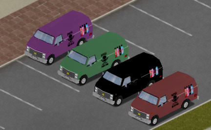
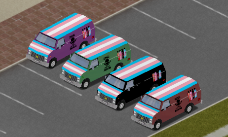

## Mansao Maromba Mod ##

## Project Goals

Learning: Created as a practical project to explore Project Zomboid Modding, asset creation, and item scripting.

Multiplayer Fun: Tailored for a co-op experience, bringing a touch of Brazilian culture and memes to the survival grind.

Aesthetic & Identity: Combining pride-themed vehicles with the Mansão Maromba aesthetic.

---

## The "Sabor Energético" Phenomenon
Inspired by the massive Brazilian meme where every spirit—be it Vodka, Whiskey, or Gin—must have that "Energetic Flavor," I've implemented a custom line of beverages.

 

---

## The Fleet: Representation & Style

I've customized a set of vans to ensure your squad travels with style and representation.

 
---
 

