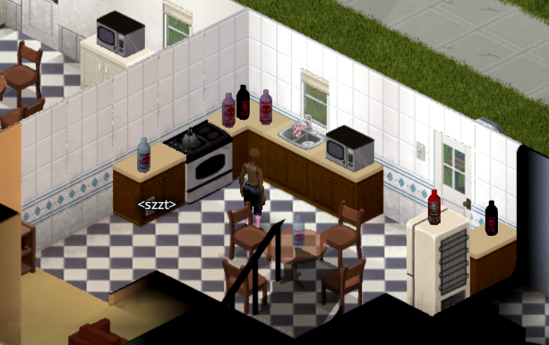
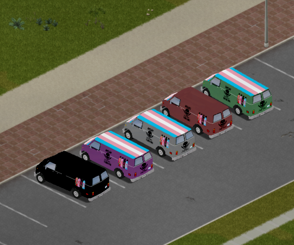
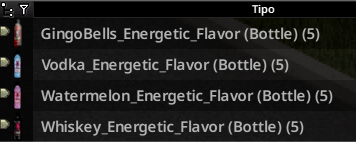
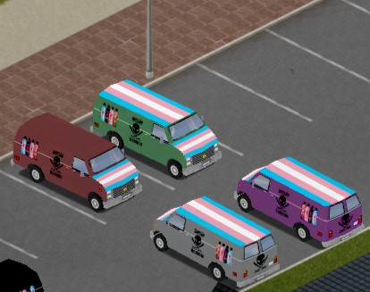

# Mansão Maromba — Project Zomboid mod

A small Project Zomboid mod with Brazilian meme inspired drinks and customized
vans for multiplayer sessions with friends.

**Status:** Personal modding experiment · Game runtime screenshots are not
included in this repository.

 

[Install the mod](#install) · [Contents](#contents) · [Project structure](#project-structure)

## Previews

| Custom drinks                          | Customized vans                         |
| -------------------------------------- | --------------------------------------- |
|  |  |

| Additional drink art                   | Additional vehicle previews              |
| -------------------------------------- | ---------------------------------------- |
|  |  |

_These are repository artwork previews, not screenshots captured in the game._

## Overview

The mod adds a custom line of energy flavored alcoholic drinks and pride themed
vehicles, built as a learning project in Project Zomboid scripting and asset
creation.

## Contents

| Content                     | Files                                                                                                                    |
| --------------------------- | ------------------------------------------------------------------------------------------------------------------------ |
| Mod metadata                | [`mod.info`](mod.info)                                                                                                   |
| Drink and fluid definitions | [`media/scripts/MM_Items.txt`](media/scripts/MM_Items.txt), [`media/scripts/MM_Fluids.txt`](media/scripts/MM_Fluids.txt) |
| Vehicle definition          | [`media/scripts/Vehicles/vehicle_vanMM.txt`](media/scripts/Vehicles/vehicle_vanMM.txt)                                   |
| Models and textures         | [`media/scripts/MM_Models.txt`](media/scripts/MM_Models.txt), [`media/textures/`](media/textures/)                       |
| Artwork previews            | [`assets/`](assets/)                                                                                                     |

## Install

1. Copy this repository folder into the Project Zomboid `mods` directory, keeping
   `mod.info` and `media/` at the mod root.
2. Start the game and enable **mansao maromba** in the Mods menu.
3. For multiplayer, enable the mod on the host and every connecting player.

The repository does not identify a tested game build. Confirm compatibility in
your target Project Zomboid version before a multiplayer session.

## Project structure

```text
mod.info
media/
  scripts/       Item, fluid, model, and vehicle definitions
  textures/      Item, world object, and vehicle textures
assets/          Repository artwork previews
```

## Project context

Created to explore Project Zomboid mod structure, item scripts, asset creation,
and a Brazilian meme inspired visual identity.

No license is currently included in this repository.
